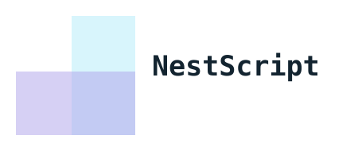
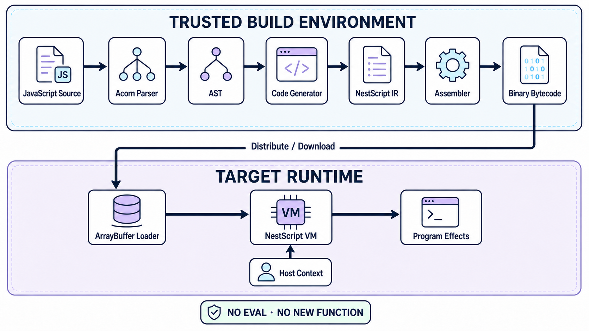

<p align="center">
  
</p>

<h1 align="center">NestScript</h1>

<p align="center">
  A JavaScript bytecode toolchain and virtual machine for environments where
  <code>eval</code>, <code>new Function</code>, and other forms of dynamic code
  generation are unavailable or prohibited.
</p>

<p align="center">
  <a href="https://github.com/livoras/nestscript/actions/workflows/node.js.yml"></a>
  <a href="https://www.npmjs.com/package/nestscript"></a>
  <a href="LICENSE"></a>
</p>

NestScript compiles a single JavaScript file ahead of time into a compact
binary program. The binary is then executed by a virtual machine implemented
entirely in TypeScript/JavaScript. The target runtime never parses or evaluates
the original source code.

This model is useful in WeChat Mini Programs, CSP-restricted web applications,
embedded JavaScript runtimes, and other hosts that allow ordinary JavaScript
execution but reject dynamic source evaluation.

> [!IMPORTANT]
> NestScript is an execution mechanism, not a security sandbox. Guest code can
> call functions and mutate objects exposed through the host context. Only run
> bytecode you trust, and expose the smallest practical host API.

## How it works



Compilation normally happens in a trusted Node.js build environment. A target
application only needs the VM, the compiled bytecode, and an explicit object
containing the host capabilities available to the program.

The toolchain has three main components:

- **Code generator** — parses JavaScript and emits NestScript assembly.
- **Assembler** — encodes assembly into the NestScript binary format.
- **Virtual machine** — executes that binary without `eval` or generated host
  JavaScript.

## Installation

```sh
npm install nestscript
```

The package installs the `nsc` command-line tool and includes the browser VM at
`node_modules/nestscript/dist/vm.js`. You can invoke the CLI through `npx`
without a global installation.

## Quick start

Create `main.js`:

```js
function greet(name) {
  return 'Hello, ' + name + '!'
}

console.log(greet('NestScript'))
```

Compile it to bytecode:

```sh
npx nsc compile main.js main.nsc
```

Run the bytecode with the Node.js host context provided by the CLI:

```sh
npx nsc run main.nsc
```

Expected output:

```text
Hello, NestScript!
```

The resulting `main.nsc` file contains bytecode, not JavaScript source. It can
be distributed independently and executed wherever a compatible NestScript VM
is available.

## Embedding the VM

### Browser or web-like runtime

The browser bundle is available at `dist/vm.js`. When loaded as a script, it
exposes `createVMFromArrayBuffer` on `window`:

```html
<script src="/vendor/nestscript/vm.js"></script>
<script>
  fetch('/programs/main.nsc')
    .then(function (response) {
      return response.arrayBuffer()
    })
    .then(function (bytecode) {
      var context = {
        console: console,
        Date: Date,
        Math: Math
      }

      var vm = createVMFromArrayBuffer(bytecode, context)
      vm.run()
    })
</script>
```

The same pattern applies to runtimes with a platform-specific networking API:
download the file as an `ArrayBuffer`, construct the VM, and call `run()`.

For production deployments, compile during the build or release process and
ship only the binary plus the VM to the target runtime.

## Host context

`createVMFromArrayBuffer(bytecode, context)` uses `context` as the program's
global object and returns a `VirtualMachine`. Host values are not imported
automatically; execution starts only when `vm.run()` is called.

```js
const context = {
  console: console,
  Date: Date,
  Math: Math,
  reportMetric: function (name, value) {
    // Bridge into the host application.
  }
}

const vm = createVMFromArrayBuffer(bytecode, context)
vm.run()
```

Keep the following properties in mind:

- Global declarations and assignments may modify the context object.
- Guest code can invoke any function reachable from the context.
- Objects reachable from the context are shared with the host, not copied.
- Providing a fresh, purpose-built context is safer than passing `window`,
  `globalThis`, or another unrestricted global object.

NestScript does not authenticate bytecode downloaded over the network. If
bytecode is delivered remotely, protect it with the same integrity and trust
controls used for any executable application asset.

## Compatibility

NestScript is currently focused on **single-file ES5 program semantics**. It
supports functions and closures, objects and arrays, constructors, control
flow, exceptions, strict mode, `with`, and interaction with explicitly supplied
host objects.

The following boundaries are intentional or currently important:

- `eval` and the `Function` constructor are not supported for guest source.
- ES modules (`import` and `export`) and classes are not supported.
- Built-in objects such as `Date`, `RegExp`, and `JSON` come from the host
  context; their exact behavior therefore depends on that host.
- The binary format is not versioned. Compile bytecode with the same
  NestScript revision used to build the target VM.
- A successfully parsed modern syntax construct is not necessarily part of the
  supported language contract; ES5 is the compatibility target.

### Test262 status

NestScript includes an isolated runner for the official historical Test262
`es5-tests` branch. At revision `04f4dc4`, the measured results are:

| Scope | Executed | Passed | Failed | Pass rate |
| --- | ---: | ---: | ---: | ---: |
| ES5 core language, chapters 6–14 | 2,745 | 2,745 | 0 | 100.00% |
| Full ES5 suite, including host built-ins | 10,613 | 10,271 | 342 | 96.78% |

Tests that require `eval` or the `Function` constructor are reported separately
and excluded from these denominators. The full-suite result also reflects
modern host built-ins and runner limits, so it should not be read as a pure VM
language score.

See [the detailed results](test262/RESULTS.md) and
[runner documentation](test262/README.md) for the pinned upstream revision,
methodology, skip policy, and failure classification.

## CLI reference

| Command | Description |
| --- | --- |
| `nsc compile <source.js> <output>` | Compile JavaScript directly to binary bytecode. |
| `nsc codegen <source.js> <output.nes>` | Emit human-readable NestScript assembly. |
| `nsc run <bytecode>` | Execute bytecode with the CLI's Node.js host context. |

Examples:

```sh
npx nsc codegen main.js main.nes
npx nsc compile main.js main.nsc
npx nsc run main.nsc
```

## Instruction set

NestScript assembly is a low-level intermediate representation with operations
for arithmetic, comparisons, property access, branching, function calls,
closures, exception handling, and object creation. The assembler converts this
representation into the binary consumed by the VM.

The binary format is currently an internal interface. The authoritative
definitions are the [VM opcode enum](src/vm/vm.ts) and the
[assembler implementation](src/assembler.ts).

## Example application

The [NestScript Racer demo](https://livoras.github.io/nestscript-demo/) runs the
game logic from a remotely loaded NestScript binary. Its source and integration
code are available in the
[nestscript-demo repository](https://github.com/livoras/nestscript-demo).

## Development

```sh
git clone https://github.com/livoras/nestscript.git
cd nestscript
npm install
npm test
```

Run the TypeScript check without emitting files:

```sh
npx tsc --noEmit
```

To reproduce the ES5 conformance run, follow
[test262/README.md](test262/README.md).

## Contributing

Bug reports and focused pull requests are welcome. For semantic changes, add a
small regression test that demonstrates the observable JavaScript behavior and
run the relevant Test262 subset when practical.

Please use [GitHub Issues](https://github.com/livoras/nestscript/issues) for bug
reports and compatibility discussions.

## License

NestScript is released under the [MIT License](LICENSE).
