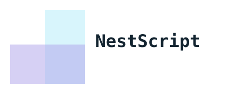
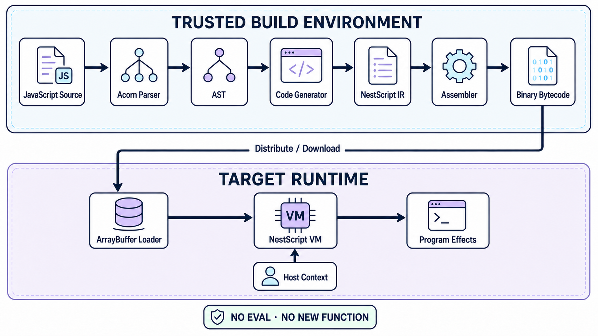

<p align="center">
  
</p>

<h1 align="center">NestScript</h1>

<p align="center">
  <a href="README.md">English</a> · 简体中文
</p>

<p align="center">
  面向无法使用或禁止使用 <code>eval</code>、<code>new Function</code>
  及其他动态代码生成能力的 JavaScript 字节码工具链与虚拟机。
</p>

<p align="center">
  <a href="https://github.com/livoras/nestscript/actions/workflows/node.js.yml"></a>
  <a href="https://www.npmjs.com/package/nestscript"></a>
  <a href="LICENSE"></a>
</p>

NestScript 将单个 JavaScript 文件预先编译为紧凑的二进制程序，再由完全使用
TypeScript/JavaScript 实现的虚拟机执行。目标运行环境不需要解析或执行原始源代码。

这种模式适用于微信小程序、受 CSP 限制的 Web 应用、嵌入式 JavaScript
运行时，以及其他允许普通 JavaScript 执行、但禁止动态执行源码的宿主环境。

> [!IMPORTANT]
> **安全边界：** NestScript 是一种代码执行机制，不是安全沙箱。虚拟机内的代码可以调用
> 宿主上下文（Host Context）暴露的函数，也可以修改其中的对象。请仅运行可信字节码，
> 并尽量缩小宿主 API 的暴露范围。

## 工作原理



编译通常在可信的 Node.js 构建环境中完成。目标应用只需要包含 NestScript
虚拟机、编译后的字节码，以及一个显式声明可用宿主能力的上下文对象。

工具链由三个核心组件组成：

- **代码生成器（Code Generator）**：解析 JavaScript 并生成 NestScript 汇编代码。
- **汇编器（Assembler）**：将汇编代码编码为 NestScript 二进制格式。
- **虚拟机（Virtual Machine）**：在不使用 `eval` 或动态生成宿主 JavaScript
  的情况下执行字节码。

## 安装

```sh
npm install nestscript
```

该软件包会安装 `nsc` 命令行工具，并在
`node_modules/nestscript/dist/vm.js` 提供浏览器版虚拟机。无需全局安装，直接通过
`npx` 即可调用 CLI。

## 快速开始

新建 `main.js`：

```js
function greet(name) {
  return 'Hello, ' + name + '!'
}

console.log(greet('NestScript'))
```

将源文件编译为字节码：

```sh
npx nsc compile main.js main.nsc
```

使用 CLI 提供的 Node.js 宿主上下文执行字节码：

```sh
npx nsc run main.nsc
```

预期输出：

```text
Hello, NestScript!
```

生成的 `main.nsc` 包含的是字节码，而不是 JavaScript 源码。它可以独立分发，并在任何
包含兼容 NestScript 虚拟机的环境中执行。

## 嵌入虚拟机

### 浏览器或类 Web 运行时

浏览器构建产物位于 `dist/vm.js`。通过 `<script>` 加载后，
`createVMFromArrayBuffer` 会挂载到 `window`：

```html
<script src="/vendor/nestscript/vm.js"></script>
<script>
  fetch('/programs/main.nsc')
    .then(function (response) {
      return response.arrayBuffer()
    })
    .then(function (bytecode) {
      var context = {
        console: console,
        Date: Date,
        Math: Math
      }

      var vm = createVMFromArrayBuffer(bytecode, context)
      vm.run()
    })
</script>
```

在使用平台专属网络 API 的运行时中，集成方式相同：以 `ArrayBuffer` 形式下载文件，
创建虚拟机实例，然后调用 `run()`。

在生产环境中，建议在构建或发布阶段完成编译，目标运行时只分发字节码和虚拟机。

## 宿主上下文（Host Context）

`createVMFromArrayBuffer(bytecode, context)` 将 `context` 作为程序的全局对象，并返回
一个 `VirtualMachine` 实例。宿主环境中的值不会被自动导入；只有调用 `vm.run()`
之后才会开始执行。

```js
const context = {
  console: console,
  Date: Date,
  Math: Math,
  reportMetric: function (name, value) {
    // 调用宿主应用提供的能力。
  }
}

const vm = createVMFromArrayBuffer(bytecode, context)
vm.run()
```

集成时需要注意：

- 全局声明和赋值可能修改 Context 对象。
- 虚拟机内的代码可以调用 Context 中任何可达的函数。
- Context 中的对象与宿主共享，并不会被复制。
- 相比直接传入 `window`、`globalThis` 或其他完整全局对象，创建一个用途明确、权限受限的
  Context 更安全。

NestScript 不负责验证通过网络下载的字节码。如果字节码需要远程分发，应当使用与其他
可执行应用资产相同的完整性校验和信任机制。

## 兼容性

NestScript 当前以**单文件 ES5 程序语义**为主要兼容目标，支持函数与闭包、对象与数组、
构造函数、控制流、异常、严格模式、`with`，以及与显式注入宿主对象之间的交互。

目前需要明确以下边界：

- 虚拟机内的源码不支持 `eval` 和 `Function` 构造器。
- 不支持 ES Modules（`import` 和 `export`）以及 `class`。
- `Date`、`RegExp`、`JSON` 等内置对象由 Host Context 提供，其具体行为取决于宿主环境。
- 二进制格式目前没有版本标识。编译字节码时，应使用与目标虚拟机相同的 NestScript 版本。
- 现代语法即使能够被解析，也不代表属于正式支持范围；当前兼容性承诺以 ES5 为准。

### Test262 测试结果

NestScript 提供了隔离执行器，用于运行官方历史版本 Test262 的 `es5-tests` 分支。
在 `04f4dc4` 版本上测得：

| 范围 | 实际执行 | 通过 | 失败 | 通过率 |
| --- | ---: | ---: | ---: | ---: |
| ES5 核心语言，第 6–14 章 | 2,745 | 2,745 | 0 | 100.00% |
| 完整 ES5 测试，包括宿主内置对象 | 10,613 | 10,271 | 342 | 96.78% |

依赖 `eval` 或 `Function` 构造器的测试会被单独统计，不计入以上分母。完整测试集的结果还会
受到现代宿主内置对象行为和执行器限制的影响，因此不能将其简单理解为虚拟机语言语义本身的
通过率。

固定的上游版本、执行方法、跳过策略和失败分类，请参阅
[详细测试结果](test262/RESULTS.md)与 [Test262 执行器文档](test262/README.md)。

## CLI 参考

| 命令 | 说明 |
| --- | --- |
| `nsc compile <source.js> <output>` | 将 JavaScript 直接编译为二进制字节码。 |
| `nsc codegen <source.js> <output.nes>` | 生成可读的 NestScript 汇编代码。 |
| `nsc run <bytecode>` | 使用 CLI 提供的 Node.js 宿主上下文执行字节码。 |

示例：

```sh
npx nsc codegen main.js main.nes
npx nsc compile main.js main.nsc
npx nsc run main.nsc
```

## 指令集

NestScript 汇编是一种低级中间表示，包含算术、比较、属性访问、跳转、函数调用、闭包、
异常处理和对象创建等操作。汇编器将这些指令编码为虚拟机执行的二进制格式。

二进制格式目前属于内部接口。当前实现以
[虚拟机 Opcode 定义](src/vm/vm.ts)和[汇编器实现](src/assembler.ts)为准。

## 示例应用

[NestScript Racer 演示](https://livoras.github.io/nestscript-demo/)通过远程加载的
NestScript 字节码运行游戏逻辑。相关源码与集成方式可在
[nestscript-demo 仓库](https://github.com/livoras/nestscript-demo)中查看。

## 开发

```sh
git clone https://github.com/livoras/nestscript.git
cd nestscript
npm install
npm test
```

执行 TypeScript 类型检查，但不生成文件：

```sh
npx tsc --noEmit
```

如需复现 ES5 兼容性测试，请参阅 [test262/README.md](test262/README.md)。

## 参与贡献

欢迎提交 Bug 报告和目标明确的 Pull Request。涉及语义修改时，请添加一个能够展示可观察
JavaScript 行为的最小回归测试，并在条件允许时运行相关 Test262 子集。

Bug 报告和兼容性讨论请使用
[GitHub Issues](https://github.com/livoras/nestscript/issues)。

## 许可证

NestScript 基于 [MIT License](LICENSE) 发布。
